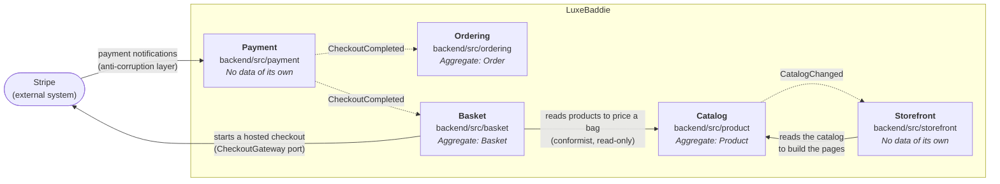

# Domain model in UML

These diagrams describe LuxeBaddie the way domain-driven design (DDD) looks at it: what the business concepts are, which service owns each one, and how they work together. They are drawn from the code as it stands, and each one names the files it was drawn from so it can be checked and kept current.

| Document | UML diagram | What it answers |
| --- | --- | --- |
| [class-diagrams.md](class-diagrams.md) | Class diagrams | What are the entities, value objects and aggregates in each bounded context, and what rules do they protect? |
| [sequence-diagrams.md](sequence-diagrams.md) | Sequence diagrams | Who calls whom, in what order, when a shopper buys something or an admin changes the catalog? |
| [activity-diagrams.md](activity-diagrams.md) | Activity diagrams | What decisions does each bounded context make, and where does each path lead? |
| [use-case-diagrams.md](use-case-diagrams.md) | Use case diagrams | What can each actor do with the system, today and on the roadmap? |

One more document sits beside the domain model: [infrastructure-diagrams.md](infrastructure-diagrams.md) shows the deployed AWS pieces (API Gateway, Lambda, DynamoDB, EventBridge, SQS, Parameter Store, CloudFront), how they connect, and where the system meets Stripe and GitHub.

The diagrams are written in [Mermaid](https://mermaid.js.org), so GitHub and most editors render them straight from the Markdown and they can be reviewed in a pull request like any other change.

## Bounded contexts

Each microservice in `backend/src/<service>` is one bounded context. The shared language between them is `packages/contracts`.

Solid arrows are direct dependencies: the arrow points at the context being depended on. Dotted arrows are domain events, pointing from publisher to subscriber. Publishers never know who is listening.

| Context | Responsibility | Relationship to the others |
| --- | --- | --- |
| Catalog | What is for sale: products, their variants and prices | Upstream of everything. Announces `CatalogChanged` |
| Basket | The shopper's bag, priced from the catalog, and the hand-off to payment | Conformist to the catalog: it reads `Product` as-is, read-only, with no translation |
| Payment | Turns what Stripe says into business events | Anti-corruption layer in front of Stripe. Publishes `CheckoutCompleted` and `CheckoutPaymentFailed` |
| Ordering | The record of what was sold, and the fulfillment queue | Downstream of payment through events only |
| Storefront | Keeps the published site in step with the catalog | Downstream of the catalog through events only |

## How the DDD terms map to this code

The code is functional TypeScript, not classes, so the building blocks look a little different from a textbook. The diagrams use UML stereotypes to say what role each element plays.

| Stereotype | Meaning here | Where it lives |
| --- | --- | --- |
| `Aggregate Root` | A thing with an identity that is loaded and saved whole, and is the only way in to what it contains | A zod schema and type in `packages/contracts/src` |
| `Entity` | Has an identity, but only inside its aggregate | Same |
| `Value Object` | Defined by its values, with no identity, never changed in place | Same |
| `Domain Service` | A business rule that does not belong to one object. Pure functions | `backend/src/<service>/domain` |
| `Factory` | Builds an aggregate in a valid state | `backend/src/<service>/domain` |
| `Application Service` | A use case: coordinates ports and domain rules | `backend/src/<service>/application/*-service.ts` |
| `Repository` / `Port` | An interface the use case needs from the outside world | `backend/src/<service>/application/ports.ts` |
| `Domain Event` | Something that happened, announced on the event bus | `packages/contracts/src/events.ts` |

Three things worth knowing before reading the class diagrams:

- **Aggregates are data, and their rules live beside them.** `Product`, `Basket` and `Order` are plain immutable records. Their invariants are enforced by the zod schema at the boundary, by pure functions in `domain/`, and by a conditional write in the repository. The diagrams show each rule on the element that enforces it.
- **Money is an integer number of cents in USD**, not a class. It appears in the diagrams as `Cents`.
- **`Customer` is not modeled yet.** A customer is identified by the email on an order. A `Customer` aggregate is planned (see `backend/DATA-MODEL.md`).

## Keeping these current

A diagram that disagrees with the code is worse than no diagram. When a change touches one of the files below, update the matching diagram in the same pull request.

| If you change | Update |
| --- | --- |
| `packages/contracts/src/*.ts` | Class diagrams |
| `backend/src/<service>/domain` or `application/ports.ts` | Class diagrams, and the activity diagram for that context |
| `backend/src/<service>/application/*-service.ts` | Activity and sequence diagrams |
| A route in `backend/src/<service>/adapters/http.ts` | Use case diagrams |
| Events, queues or subscriptions in `backend/lib` | Sequence diagrams and the context map above |
| Any construct in `backend/lib`, `backend/scripts/stripe-setup.ts` or `.github/workflows` | Infrastructure diagrams |

Related reading: the system overview in the [README](../README.md), and the storage model in [backend/DATA-MODEL.md](../backend/DATA-MODEL.md). The diagrams here stop at the repository interface on purpose: how an aggregate is stored is that document's job.
