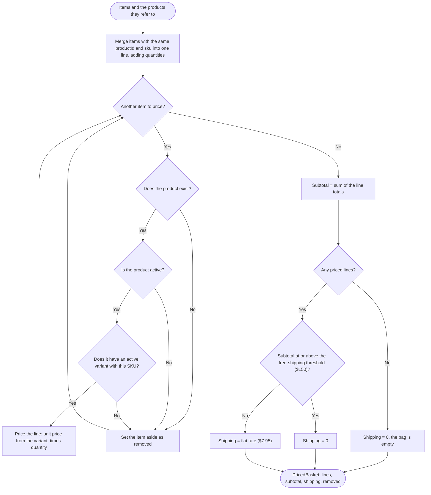
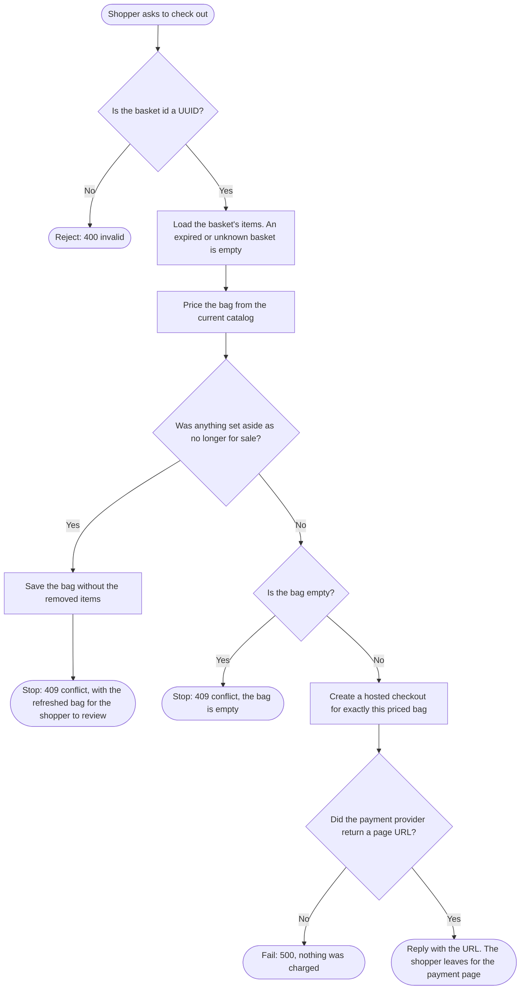
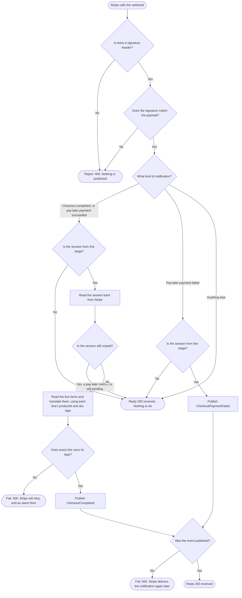
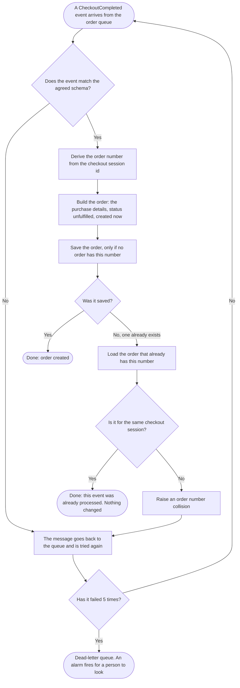
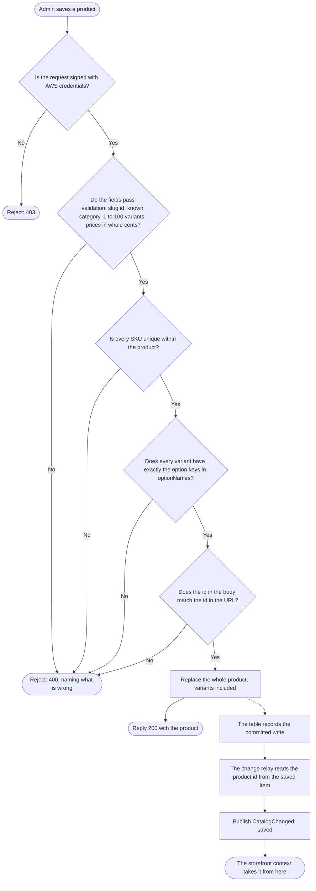
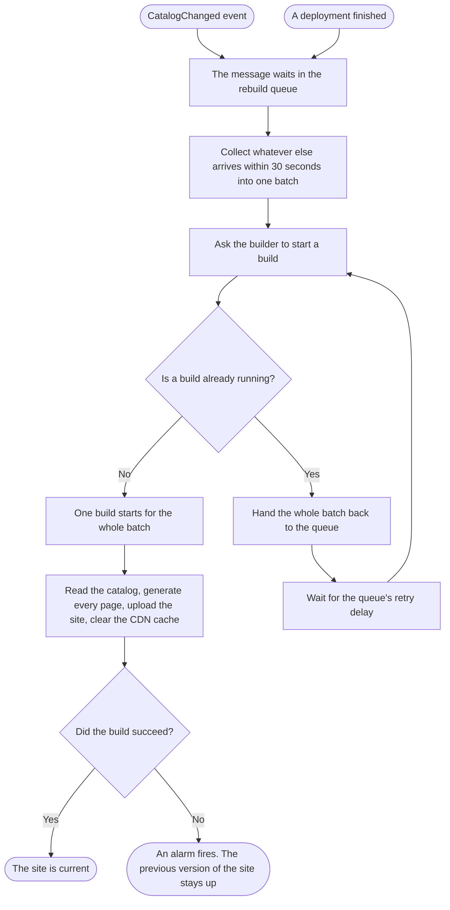

# Activity diagrams

The flow of events and decisions inside each bounded context. Rounded nodes are the start and finish, rectangles are actions, and diamonds are decisions. Where a path leaves the context (an event published, a reply sent) the node says so.

These follow the application service and domain functions of each context line by line, so a changed rule should show up here as a changed branch. See the [index](README.md) for the bounded contexts.

## Basket: pricing a bag

The rule every other basket flow depends on. Pure domain logic with no outside calls.

Source: `backend/src/basket/domain/pricing.ts`, `backend/src/basket/domain/shipping.ts`.

The shipping numbers are placeholders until vendor shipping costs are known (see the roadmap).

## Basket: starting checkout

Source: `backend/src/basket/application/basket-service.ts` (`startCheckout`).

The order of the two checks matters. A bag whose last item was just delisted is reported as "no longer available", not as "empty", so the shopper learns why.

## Payment: handling a notification

Source: `backend/src/payment/adapters/http.ts`, `backend/src/payment/application/payment-service.ts`, `backend/src/payment/adapters/stripe-payment-provider.ts`.

A pay-later purchase passes through here twice: once at checkout, where the session is still unpaid and nothing is published, and again when the payment succeeds or fails.

## Ordering: recording a paid checkout

Source: `backend/src/ordering/adapters/order-queue.ts`, `backend/src/ordering/application/order-service.ts`, `backend/src/ordering/domain/order.ts`.

Two different payments mapping to one order number is astronomically unlikely, but the flow makes sure it would be loud. A paid order is never silently dropped.

## Catalog: saving a product

Source: `backend/src/product/adapters/http.ts`, `packages/contracts/src/catalog.ts` (`productSchema`), `backend/src/product/adapters/catalog-change-stream.ts`.

The dotted line is the hand-off from the request to the background: the admin gets their reply as soon as the product is saved, and the event follows from the table's own record of the write. Removing a product follows the same path and publishes `CatalogChanged: removed`.

## Storefront: bringing the site up to date

Source: `backend/src/storefront/adapters/rebuild-queue.ts`, `backend/src/storefront/application/storefront-service.ts`.

Why a busy builder defers instead of dropping the request: the build that is already running may have read the catalog before this change was made, so it does not count. Trying again later guarantees a build that starts after the last change.
