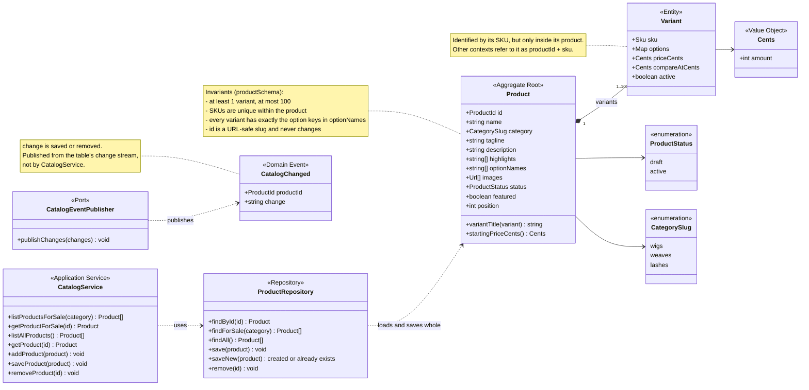
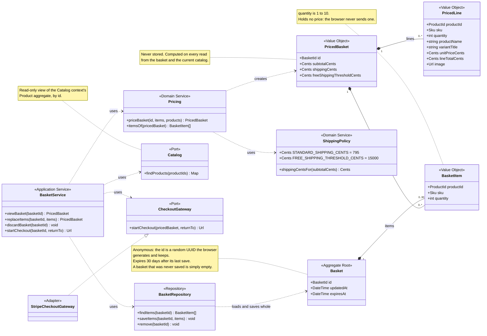
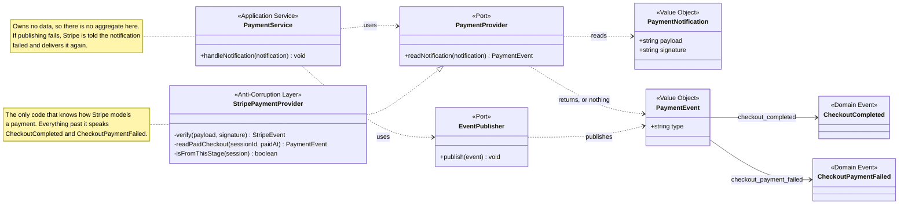
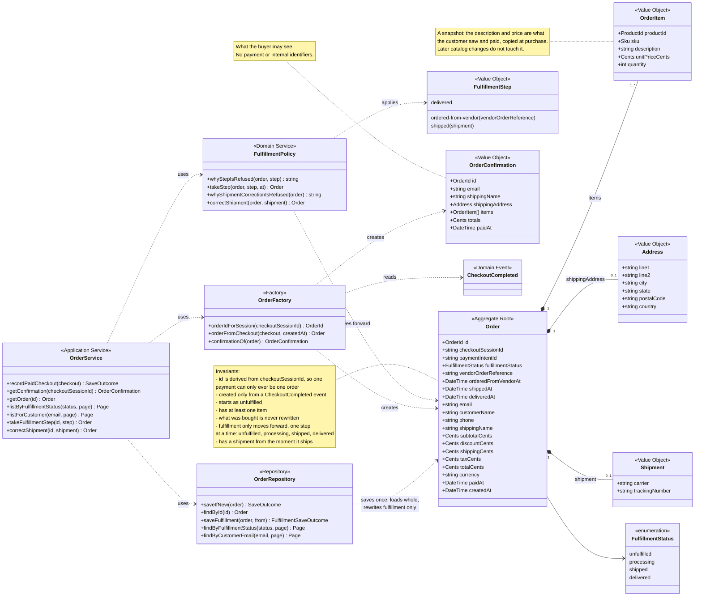
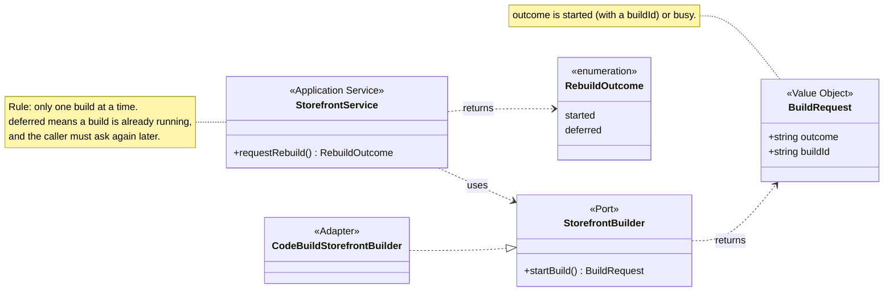
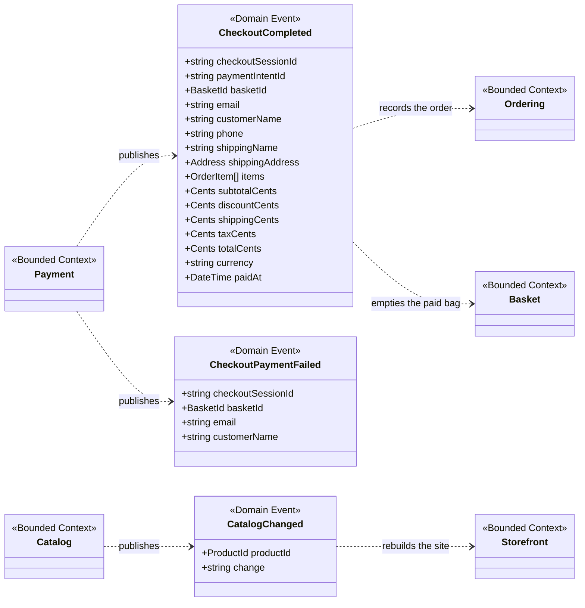

# Class diagrams

Entities, value objects and aggregates, one diagram per bounded context. See the [index](README.md) for what each stereotype means in this codebase.

How to read them:

- A filled diamond (`*--`) is composition: the part lives and dies with its aggregate and is stored inside it.
- A dashed arrow (`..>`) is a dependency: "uses" or "creates".
- A dashed arrow with a hollow head (`..|>`) is an adapter implementing a port.
- One aggregate never holds a reference to another aggregate's object. It holds the other's id (`productId`, `basketId`, `checkoutSessionId`).

## Catalog

Source: `packages/contracts/src/catalog.ts`, `backend/src/product/application`.

Notes:

- **Aggregate boundary.** A product is always saved and read whole, variants included. There is no "update one variant" operation: an admin save replaces the product.
- **For sale** means the product is `active` and the variant is `active`. Shoppers only ever see products for sale; admins see drafts too.
- **`CatalogService` does not publish events.** It only saves. `CatalogChanged` is produced by the change relay (`backend/src/product/change-relay.ts`) from the record of committed writes, so the event and the data cannot disagree.

## Basket

Source: `packages/contracts/src/basket.ts`, `backend/src/basket/domain`, `backend/src/basket/application`.

Notes:

- **What is stored and what is computed.** The stored aggregate is small: an id and up to 30 `BasketItem`s. `PricedBasket` is a value computed fresh each time, so a price change in the catalog shows up in the bag on the next read, and a tampered request cannot change what the shopper pays.
- **Pricing rules** (`domain/pricing.ts`): repeated `productId` + `sku` pairs are merged into one line; an item whose product or variant is no longer for sale is moved to `removed` rather than priced; shipping is the flat rate below the free-shipping threshold and zero at or above it; an empty bag has no shipping.
- **The basket refers to products by id only.** `Catalog` is the basket's own narrow port onto another context's data, which is why it is named for what the basket needs and not after the product service.

## Payment

Source: `backend/src/payment/application`, `backend/src/payment/adapters/stripe-payment-provider.ts`.

Notes:

- **No aggregate, by design.** This context is a translator. Its whole job is to turn Stripe's vocabulary (`checkout.session.completed`, `payment_status`, line item metadata) into the business's vocabulary, and announce it.
- **`PaymentEvent` is a tagged union** of the two domain events. `readNotification` returns nothing for notifications the business does not act on: other event types, sessions from another stage, and sessions whose pay-later payment is still pending.

## Ordering

Source: `packages/contracts/src/order.ts`, `backend/src/ordering/domain/order.ts`, `backend/src/ordering/application`.

Notes:

- **The order number is the idempotency key.** `orderIdForSession` hashes the checkout session id into a readable number like `LB-7K3M9Q2XAB`. The same session always gives the same number, and `saveIfNew` refuses to overwrite, so a payment event delivered twice still produces one order.
- **An order copies what it needs and keeps it.** `OrderItem` carries `productId` and `sku` as references back to the catalog, but its description and price are frozen at purchase.
- **`Customer` is implicit.** Today a customer is the `email` on their orders, which is what `findByCustomerEmail` uses. There is no `Customer` aggregate yet.
- **Fulfillment only moves forward.** `domain/fulfillment.ts` holds the rule: `unfulfilled` to `processing` (ordered from the vendor) to `shipped` to `delivered`, one step at a time, never skipping and never back. A refused step comes with the reason in plain words, which the back office shows as is. The one change allowed without moving is correcting the carrier or tracking number while an order is on its way.
- **Two people cannot both move one order.** `saveFulfillment` only stores a change if the order is still in the status the change started from, so the second person is told the order changed instead of overwriting the first.

## Storefront

Source: `backend/src/storefront/application`.

Notes:

- **No aggregate here either.** The published site is derived entirely from the catalog, so this context holds one rule and no data: an older build must never finish after a newer one.

## Domain events

Source: `packages/contracts/src/events.ts`. These are the published language between contexts.

| Event | Source | Means | Subscribers today |
| --- | --- | --- | --- |
| `CheckoutCompleted` | `com.luxebaddie.payment` | A shopper paid, confirmed by Stripe | Ordering, Basket |
| `CheckoutPaymentFailed` | `com.luxebaddie.payment` | A pay-later payment was declined after checkout. Nothing was charged and no order exists | None yet (telling the shopper is on the roadmap) |
| `CatalogChanged` | `com.luxebaddie.product` | A product was saved or removed | Storefront |

`CheckoutCompleted` carries everything an order needs, so the ordering context never has to call back to payment or Stripe. Delivery is at-least-once, so every subscriber is idempotent.
