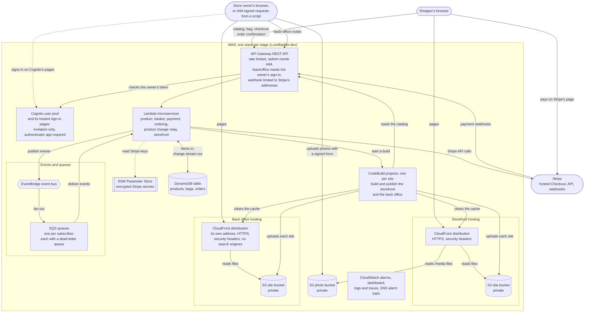
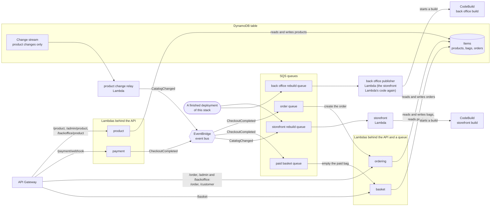
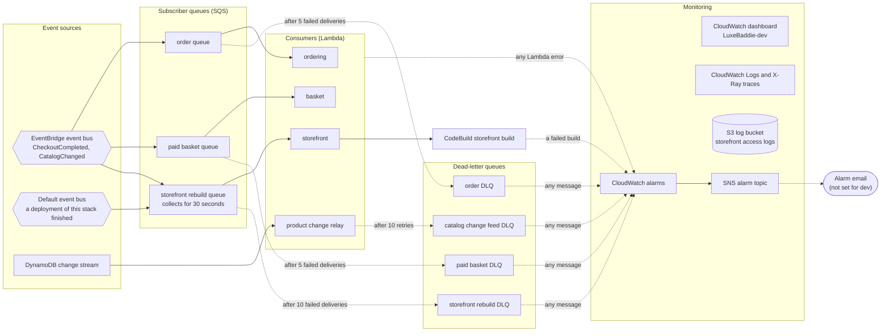

# Infrastructure diagrams

What runs where: the AWS pieces that make up one stage of LuxeBaddie, how they connect to each other, and where the system touches the outside world (shoppers, the store owner, Stripe, GitHub).

The other documents in this folder describe the domain and stop at the repository interface. This one starts there: it shows the deployed resources, not the business rules. It is drawn from the CDK code in `backend/lib`, which is the source of truth. Each diagram names the files it was drawn from.

Everything inside the "AWS" box is one CloudFormation stack per stage, named `LuxeBaddie-<stage>` (`backend/bin`, `backend/lib/luxebaddie-stack.ts`). Only `dev` exists today. A stage is a fully separate copy: its own table, queues, API, storefront and Stripe sandbox. The one thing kept outside that stack is the pair of roles GitHub deploys and previews the stage with, in `LuxeBaddie-<stage>-DeployAccess` (diagram 5).

Arrow styles are the same in every diagram:

- A solid arrow is a call or a delivery, pointing from the caller to the thing called.
- A dotted arrow is something that happens outside a shopper's request: reading a secret, a manual step, or an alarm.

## 1. The whole system

Source: `backend/lib/luxebaddie-stack.ts` and every construct it creates.

This is the map. Monitoring watches every piece, so its arrows are left out here and drawn in diagram 4. The Lambda box is opened up in diagram 2, and the Stripe and secrets connections in diagram 3.

### What each piece is for

| Piece | AWS service | What it does | Defined in |
| --- | --- | --- | --- |
| Storefront hosting | CloudFront, S3 | Serves the static site over HTTPS. The bucket is private and only this distribution can read it. A CloudFront Function maps `/shop` to `shop.html` | `lib/site-hosting.ts`, `lib/site-page-router.js` |
| Product photos | S3, behind the storefront's CloudFront | A private bucket of product photos, served to shoppers at the storefront's address under `/media/`. The back office uploads to it directly with a signed form the product service issues: one file, an agreed kind, at most 5 MB | `lib/product-photos.ts`, `src/product/adapters/s3-photo-store.ts` |
| Back office hosting | CloudFront, S3 | The same construct a second time: the owner's private site at its own address, with one more header asking search engines not to list it | `lib/site-hosting.ts`, `lib/site-page-router.js` |
| API | API Gateway (REST) | One base URL in front of every service. 50 requests a second, bursts of 100. Its resource policy decides who may call which route | `lib/apigateway.ts` |
| Owner sign-in | Cognito | The store owner's account for the back office, and the sign-in pages Cognito hosts for it. Nobody can register, every sign-in needs a code from an authenticator app, a session lasts 12 hours and one token 15 minutes. A signed-in owner is only ever returned to the back office's own addresses | `lib/owner-sign-in.ts`, `scripts/invite-owner.ts` |
| Microservices | Lambda | Seven functions, one job each. ARM, 512 MB, 25 second timeout, JSON logs, tracing on | `lib/microservices.ts` |
| Database | DynamoDB | One on-demand table for products, bags and orders, with two overloaded indexes, expiry on bags, and a change stream | `lib/database.ts`, `backend/DATA-MODEL.md` |
| Secrets | SSM Parameter Store | Holds the Stripe keys and webhook signing secret as encrypted `SecureString` parameters | `lib/stage-config.ts`, `scripts/stripe-setup.ts` |
| Event bus | EventBridge | Publish-subscribe: one rule per event type fans it out to each subscriber's queue | `lib/eventbus.ts` |
| Queues | SQS | Each subscriber's inbox, with its own retries and dead-letter queue | `lib/queue.ts` |
| Change feed | DynamoDB Streams to Lambda | Turns saved product changes into `CatalogChanged` events, so the event can never disagree with the table | `lib/change-feed.ts` |
| Site builds | CodeBuild | One project per site. Builds the Next.js site from the deployed source (and, for the storefront, the live catalog), uploads it, and clears CloudFront's cache. One build at a time per site | `lib/site-build.ts` |
| Monitoring | CloudWatch, SNS, X-Ray | Alarms, one dashboard, logs and request traces | `lib/monitoring.ts` |

### Who can reach what

Access is enforced by the infrastructure, not by convention.

| Boundary | Rule | Enforced by |
| --- | --- | --- |
| Internet to a site bucket | Never directly. Only through that site's CloudFront distribution | Bucket policy naming the one distribution (origin access control) |
| Internet to the photo bucket | Reading: never directly, only through the storefront's distribution. Writing: only with a signed upload form, which the product service gives a caller of the back-office routes | Bucket policy naming the storefront's distribution; the form's signed conditions, enforced by S3; a CORS rule admitting form posts from the back office's pages only |
| Internet to the back office's pages | Anyone can fetch the page files, which hold the screens' code and no store data. They show one line, "Taking you to sign-in", until the visitor has signed in | The sign-in check around every screen (`backoffice/src/auth/signed-in-only.tsx`). The data is protected by the `/backoffice` row below |
| Internet to public API routes | Anyone, rate limited: `GET /product`, `/basket/{id}`, `GET /order/session/{sessionId}` | API Gateway resource policy and stage throttling |
| Internet to `/admin` routes | Only AWS identities in this account with permission to invoke them, with signed requests (SigV4) | IAM authorization on each admin method |
| Internet to `/backoffice` routes | Only a signed-in owner. The same functions as `/admin`, behind a different check | Cognito authorizer on each back-office method, checking every request's token against the user pool |
| Anyone to an owner account | Nobody can create one for themselves. Signing in takes the password and a code from the owner's authenticator app | The user pool: sign-up off, second factor required, text-message and email codes off |
| Internet to `POST /payment/webhook` | Only from Stripe's published addresses, and then only with a valid Stripe signature | Resource policy deny (`lib/stripe-webhook-ips.ts`), then signature check in the payment service |
| A service to the table | Only items whose key starts with its own prefix. Basket may also read products | IAM conditions on `dynamodb:LeadingKeys` |
| A service to a secret | Only its own parameters | IAM grants per parameter (checked by `test/unit/stack.test.ts`) |
| GitHub Actions to AWS | Only this repository, and each role only from the kind of run it is for. Credentials last an hour at most; no key is stored | Each role's trust policy, matching the repository and run in GitHub's token exactly (diagram 5) |
| Browser to other origins | The storefront: only itself and the stage's API. The back office: itself, the API and the sign-in service | Content-Security-Policy written into each page by the build |
| The storefront to the back office | Nothing in common: separate addresses, so separate browser origins, buckets and distributions. A script running on the storefront cannot read the owner's session | Two `LbSiteHosting` constructs (`lib/luxebaddie-stack.ts`) |

## 2. Inside the backend

Which service touches what. Stripe and Parameter Store are left out here and drawn in diagram 3.

Source: `backend/lib/microservices.ts`, `backend/lib/apigateway.ts`, `backend/lib/eventbus.ts`, `backend/lib/queue.ts`, `backend/lib/change-feed.ts`, `backend/lib/luxebaddie-stack.ts`.

- **Services never call each other.** They share the table (each limited to its own items) and otherwise talk through events.
- **The payment service stores nothing.** It verifies what Stripe says and announces it.
- **The product change relay and the storefront Lambda have no table access.** The relay's only input is the change stream and its only output the event bus. The storefront Lambda can only start the build.

## 3. Stripe and secrets

Where the Stripe keys live, how they get there, and every point where this system and Stripe talk to each other.

Source: `backend/scripts/stripe-setup.ts`, `backend/lib/stage-config.ts`, `backend/lib/microservices.ts`, `backend/src/shared/adapters/ssm-secrets.ts`, `backend/lib/apigateway.ts`.

| Secret | Parameter | Read by | Stripe permissions |
| --- | --- | --- | --- |
| Basket service key | `/luxebaddie/<stage>/stripe/basket-api-key` | basket Lambda only | Checkout Sessions: Write |
| Payment service key | `/luxebaddie/<stage>/stripe/payment-api-key` | payment Lambda only | Checkout Sessions: Read, Products: Read |
| Webhook signing secret | `/luxebaddie/<stage>/stripe/webhook-secret` | payment Lambda only | Verifies that a webhook really came from Stripe |
| Setup key | Not stored anywhere | The setup script, while it runs | Webhook Endpoints: Write |

Things worth knowing:

- **The keys are never in code, Lambda environment variables or CloudFormation templates.** The Lambdas are given the parameter's name, not its value, and fetch the value when they need it.
- **Card details never enter AWS.** The shopper pays on Stripe's hosted page. This system only creates the checkout session and hears about the result.
- **Rotating a key needs no deployment.** Create the new key in Stripe, run the setup script again, and each Lambda picks it up within 5 minutes. Give the old key a short expiry in Stripe rather than revoking it immediately, so Lambdas still holding the old value keep working until their cache refreshes.
- **The parameters are encrypted with the account's default AWS-managed KMS key for Parameter Store.** A dedicated key for `prod` is recommended when that stage is built (see "Not built yet" below).

## 4. Failures and monitoring

Where work goes when it fails, and how anyone finds out.

Source: `backend/lib/queue.ts`, `backend/lib/change-feed.ts`, `backend/lib/eventbus.ts`, `backend/lib/monitoring.ts`, `backend/lib/site-build.ts`, `backend/lib/site-hosting.ts`.

Alarms that are not drawn above, to keep the picture readable: the API returning five or more 5xx errors in five minutes, the storefront returning 5xx for 5% or more of requests, and errors from the product and payment Lambdas. Every Lambda, the API, the queues, the storefront and the build are on the dashboard.

| What fails | What happens | How you find out |
| --- | --- | --- |
| A subscriber cannot process an event | SQS redelivers it. After 5 tries (10 for site rebuilds) it moves to that subscriber's dead-letter queue. Other subscribers are unaffected | Dead-letter alarm |
| EventBridge cannot deliver to a queue | The event goes to the same dead-letter queue | Dead-letter alarm |
| A product change cannot be announced | The batch is split to isolate the bad change, retried 10 times, then described in the change feed's dead-letter queue | Change feed alarm |
| A storefront or back office build fails | The previous version of that site stays live | That site's build failed alarm |
| A build is requested while one is running | CodeBuild refuses it. The request waits in the queue and is retried, up to half an hour | Nothing, this is normal |
| Stripe cannot reach the webhook, or it errors | Stripe redelivers until it gets a success response | Payment Lambda error alarm, API 5xx alarm |

Logs are kept for one month in `dev` (six months where `retainData` is on). CloudFront access logs go to a private S3 bucket without query strings, referrers or cookies, because the order confirmation address contains the checkout session id, and back-office addresses contain order numbers and customer emails.

## 5. How changes get to AWS

Source: `.github/workflows/ci.yml`, `.github/workflows/infrastructure-diff.yml`, `.github/workflows/deploy.yml`, `backend/lib/github-actions.ts`, `backend/lib/deploy-access-stack.ts`, `backend/lib/end-to-end-test-access.ts`, `backend/lib/site-build.ts`, `backend/scripts/wait-for-sites.ts`.

```mermaid
flowchart LR
    owner(["Store owner"])

    subgraph github["GitHub"]
        pr["Pull request to main"]
        ci["CI<br/>typecheck, lint, unit tests,<br/>CDK build, secret scan"]
        diff["Infrastructure diff<br/>comments what would change"]
        merge["Merge to main"]
        checks["Deploy: checks again<br/>on the merged result"]
        deploy["Deploy: cdk deploy,<br/>then wait for the storefront<br/>(dev environment, main only)"]
        e2e["Deploy: end-to-end tests"]
    end

    subgraph aws["AWS"]
        sts["STS<br/>swaps GitHub's token for<br/>credentials that expire in an hour"]
        previewRole["Role: github-preview<br/>read dev's template"]
        deployRole["Role: github-deploy<br/>use the CDK's deploy roles"]
        testRole["Role: github-e2e<br/>what the tests do"]

        subgraph stage["LuxeBaddie-dev"]
            cfn["CloudFormation stack"]
            source[("S3: storefront source<br/>uploaded by CDK")]
            rebuildQueue["SQS storefront rebuild queue"]
            codebuild["CodeBuild storefront build"]
            site["S3 site bucket and CloudFront"]
            api["API, event bus, table"]
        end
    end

    owner -- "pushes a branch" --> pr
    pr --> ci
    pr --> diff
    owner -- "merges once CI is green" --> merge
    merge --> checks --> deploy --> e2e

    diff -. "token: a pull request" .-> sts
    deploy -. "token: environment dev" .-> sts
    e2e -. "token: branch main" .-> sts
    sts -.-> previewRole
    sts -.-> deployRole
    sts -.-> testRole

    previewRole -- "reads the template" --> cfn
    deployRole -- "deploys" --> cfn
    deployRole -- "uploads the storefront source" --> source
    cfn -- "deployment finished" --> rebuildQueue
    rebuildQueue -- "via the storefront Lambda" --> codebuild
    source --> codebuild
    codebuild -- "publishes, with the time<br/>the build started" --> site
    deploy -- "waits for a build newer<br/>than the deployment" --> site
    testRole -- "exercises" --> api
    e2e -- "checks" --> site
```

- **Merging is the deploy.** Every push to `main` runs the checks again on the merged result, deploys the backend and the storefront's hosting to `dev`, waits for the storefront to be rebuilt, and then runs the end-to-end tests against the live stage. One run at a time, and a run that has started is never cancelled.
- **No AWS key is stored in GitHub.** For each job GitHub issues a short-lived token that describes the run: which repository, and which branch, environment or pull request. AWS swaps it for credentials that expire within the hour, and only for the role whose conditions the run meets exactly (OpenID Connect).
- **Three roles, one per job.**

  | Role | Which runs can use it | What it can do | Defined in |
  | --- | --- | --- | --- |
  | `luxebaddie-dev-github-preview` | Pull requests from branches of this repository | Read `dev`'s CloudFormation template. Nothing else | `lib/deploy-access-stack.ts` |
  | `luxebaddie-dev-github-deploy` | Jobs in the `dev` GitHub environment, which only accepts the `main` branch | Use the roles `cdk bootstrap` created to deploy, and read the stack's status and events | `lib/deploy-access-stack.ts` |
  | `luxebaddie-dev-github-e2e` | Jobs on the `main` branch | Read the stack's outputs, call the `/admin` routes, publish a `CheckoutCompleted` event, delete order items, create, sign in as and delete an owner in `dev`'s user pool, and see whether the Stripe parameters exist | `lib/end-to-end-test-access.ts` |

- **The pipeline cannot change who the pipeline is.** The preview and deploy roles live in their own stack, `LuxeBaddie-dev-DeployAccess`, which is deployed by hand once per stage and which no workflow deploys.
- **A pull request gets as little as possible**, because it runs code nobody has reviewed yet. Its comparison is template against template, which needs nothing but read access to one stack. Pull requests from forks and from Dependabot cannot sign in at all.
- **Deploying is still administrator-level.** CloudFormation makes the changes with the role `cdk bootstrap` created for it, which can do anything in this account. So anything merged to `main` can change anything in the account: the ruleset on `main` is the guard. Narrowing this is part of the production account decision in [ROADMAP.md](../ROADMAP.md).
- **Stripe is outside the pipeline.** No workflow reads or writes a Stripe key. Connecting a stage to Stripe stays the manual step in diagram 3. The test role can see that the parameters exist, never their values.
- **The deploy job is only done when both sites are.** A deployment starts a build of the storefront and one of the back office, and returns. Each build writes the time it started to `/build.json` on its site, and the job waits until both live sites carry a time later than the deployment's end. If a build fails, the job fails and the previous version of that site stays up.
- **The site is only ever published by the build.** There is no "upload the site" command, so what is live always matches the deployed source and the current catalog.
- **Workflow logs are public**, because the repository is. The AWS account number is kept as a GitHub secret so it is masked in them, and it is removed from the pull request comment before posting. It is the only AWS detail GitHub stores.

## Not built yet

These are planned in [ROADMAP.md](../ROADMAP.md) and are deliberately absent from the diagrams above. When one lands, add it here in the same pull request.

| Planned piece | Where it will appear |
| --- | --- |
| A `prod` stage with live restricted Stripe keys, backups on and an alarm email | A second stack, identical in shape to `dev`, without the end-to-end test role |
| A production deploy that waits for approval in GitHub, with its own deploy role | Diagram 5: a `prod` environment and role next to the `dev` ones |
| A custom domain with its certificate and DNS | Diagram 1: in front of CloudFront |
| A web application firewall, or a CloudFront flat-rate plan | Diagram 1: in front of CloudFront |
| A dedicated KMS key for the `prod` Stripe parameters, and an alarm on unexpected reads of them | Diagram 3 |
| A spending alert for `prod` | Diagram 4: next to the alarm topic |
| Order confirmation and shipping emails, vendor order forwarding | Diagram 2: new subscriber queues on the event bus |

## Keeping this current

When a change touches a construct in `backend/lib`, the setup script, or a workflow in `.github/workflows`, update the matching diagram and table here in the same pull request. `backend/lib/luxebaddie-stack.ts` is the quickest way to check diagrams 1 and 2: every construct it creates should appear, and nothing else.
