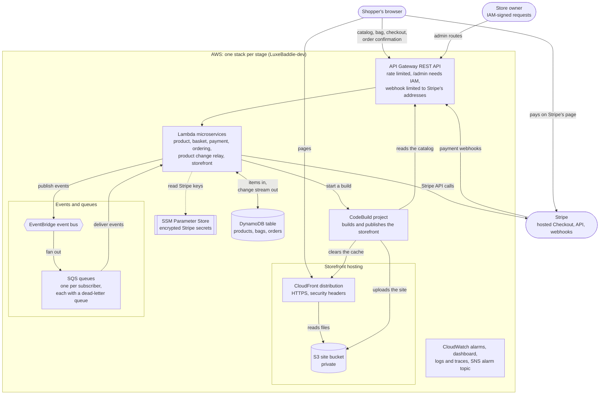
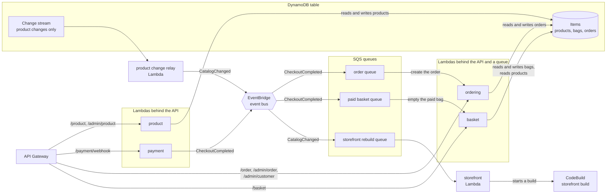
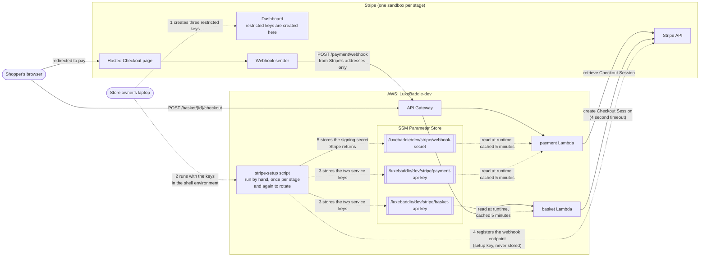
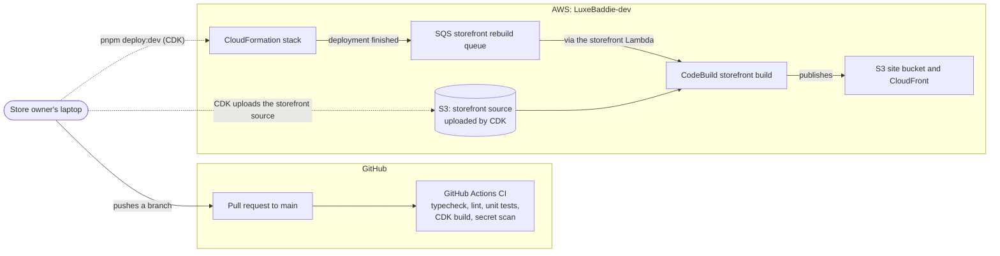

# Infrastructure diagrams

What runs where: the AWS pieces that make up one stage of LuxeBaddie, how they connect to each other, and where the system touches the outside world (shoppers, the store owner, Stripe, GitHub).

The other documents in this folder describe the domain and stop at the repository interface. This one starts there: it shows the deployed resources, not the business rules. It is drawn from the CDK code in `backend/lib`, which is the source of truth. Each diagram names the files it was drawn from.

Everything inside the "AWS" box is one CloudFormation stack per stage, named `LuxeBaddie-<stage>` (`backend/bin`, `backend/lib/luxebaddie-stack.ts`). Only `dev` exists today. A stage is a fully separate copy: its own table, queues, API, storefront and Stripe sandbox.

Arrow styles are the same in every diagram:

- A solid arrow is a call or a delivery, pointing from the caller to the thing called.
- A dotted arrow is something that happens outside a shopper's request: reading a secret, a manual step, or an alarm.

## 1. The whole system

Source: `backend/lib/luxebaddie-stack.ts` and every construct it creates.

This is the map. Monitoring watches every piece, so its arrows are left out here and drawn in diagram 4. The Lambda box is opened up in diagram 2, and the Stripe and secrets connections in diagram 3.

### What each piece is for

| Piece | AWS service | What it does | Defined in |
| --- | --- | --- | --- |
| Storefront hosting | CloudFront, S3 | Serves the static site over HTTPS. The bucket is private and only this distribution can read it. A CloudFront Function maps `/shop` to `shop.html` | `lib/storefront-hosting.ts`, `lib/storefront-page-router.js` |
| API | API Gateway (REST) | One base URL in front of every service. 50 requests a second, bursts of 100. Its resource policy decides who may call which route | `lib/apigateway.ts` |
| Microservices | Lambda | Six functions, one job each. ARM, 512 MB, 25 second timeout, JSON logs, tracing on | `lib/microservices.ts` |
| Database | DynamoDB | One on-demand table for products, bags and orders, with two overloaded indexes, expiry on bags, and a change stream | `lib/database.ts`, `backend/DATA-MODEL.md` |
| Secrets | SSM Parameter Store | Holds the Stripe keys and webhook signing secret as encrypted `SecureString` parameters | `lib/stage-config.ts`, `scripts/stripe-setup.ts` |
| Event bus | EventBridge | Publish-subscribe: one rule per event type fans it out to each subscriber's queue | `lib/eventbus.ts` |
| Queues | SQS | Each subscriber's inbox, with its own retries and dead-letter queue | `lib/queue.ts` |
| Change feed | DynamoDB Streams to Lambda | Turns saved product changes into `CatalogChanged` events, so the event can never disagree with the table | `lib/change-feed.ts` |
| Storefront build | CodeBuild | Builds the Next.js site from the deployed source and the live catalog, uploads it, and clears CloudFront's cache. One build at a time | `lib/storefront-build.ts` |
| Monitoring | CloudWatch, SNS, X-Ray | Alarms, one dashboard, logs and request traces | `lib/monitoring.ts` |

### Who can reach what

Access is enforced by the infrastructure, not by convention.

| Boundary | Rule | Enforced by |
| --- | --- | --- |
| Internet to the site bucket | Never directly. Only through CloudFront | Bucket policy naming this one distribution (origin access control) |
| Internet to public API routes | Anyone, rate limited: `GET /product`, `/basket/{id}`, `GET /order/session/{sessionId}` | API Gateway resource policy and stage throttling |
| Internet to `/admin` routes | Only AWS identities in this account with permission to invoke them, with signed requests (SigV4) | IAM authorization on each admin method |
| Internet to `POST /payment/webhook` | Only from Stripe's published addresses, and then only with a valid Stripe signature | Resource policy deny (`lib/stripe-webhook-ips.ts`), then signature check in the payment service |
| A service to the table | Only items whose key starts with its own prefix. Basket may also read products | IAM conditions on `dynamodb:LeadingKeys` |
| A service to a secret | Only its own parameters | IAM grants per parameter (checked by `test/unit/stack.test.ts`) |
| Browser to other origins | Only the site itself and the stage's API | Content-Security-Policy written into each page by the build |

## 2. Inside the backend

Which service touches what. Stripe and Parameter Store are left out here and drawn in diagram 3.

Source: `backend/lib/microservices.ts`, `backend/lib/apigateway.ts`, `backend/lib/eventbus.ts`, `backend/lib/queue.ts`, `backend/lib/change-feed.ts`, `backend/lib/luxebaddie-stack.ts`.

- **Services never call each other.** They share the table (each limited to its own items) and otherwise talk through events.
- **The payment service stores nothing.** It verifies what Stripe says and announces it.
- **The product change relay and the storefront Lambda have no table access.** The relay's only input is the change stream and its only output the event bus. The storefront Lambda can only start the build.

## 3. Stripe and secrets

Where the Stripe keys live, how they get there, and every point where this system and Stripe talk to each other.

Source: `backend/scripts/stripe-setup.ts`, `backend/lib/stage-config.ts`, `backend/lib/microservices.ts`, `backend/src/shared/adapters/ssm-secrets.ts`, `backend/lib/apigateway.ts`.

| Secret | Parameter | Read by | Stripe permissions |
| --- | --- | --- | --- |
| Basket service key | `/luxebaddie/<stage>/stripe/basket-api-key` | basket Lambda only | Checkout Sessions: Write |
| Payment service key | `/luxebaddie/<stage>/stripe/payment-api-key` | payment Lambda only | Checkout Sessions: Read, Products: Read |
| Webhook signing secret | `/luxebaddie/<stage>/stripe/webhook-secret` | payment Lambda only | Verifies that a webhook really came from Stripe |
| Setup key | Not stored anywhere | The setup script, while it runs | Webhook Endpoints: Write |

Things worth knowing:

- **The keys are never in code, Lambda environment variables or CloudFormation templates.** The Lambdas are given the parameter's name, not its value, and fetch the value when they need it.
- **Card details never enter AWS.** The shopper pays on Stripe's hosted page. This system only creates the checkout session and hears about the result.
- **Rotating a key needs no deployment.** Create the new key in Stripe, run the setup script again, and each Lambda picks it up within 5 minutes. Give the old key a short expiry in Stripe rather than revoking it immediately, so Lambdas still holding the old value keep working until their cache refreshes.
- **The parameters are encrypted with the account's default AWS-managed KMS key for Parameter Store.** A dedicated key for `prod` is recommended when that stage is built (see "Not built yet" below).

## 4. Failures and monitoring

Where work goes when it fails, and how anyone finds out.

Source: `backend/lib/queue.ts`, `backend/lib/change-feed.ts`, `backend/lib/eventbus.ts`, `backend/lib/monitoring.ts`, `backend/lib/storefront-build.ts`, `backend/lib/storefront-hosting.ts`.

Alarms that are not drawn above, to keep the picture readable: the API returning five or more 5xx errors in five minutes, the storefront returning 5xx for 5% or more of requests, and errors from the product and payment Lambdas. Every Lambda, the API, the queues, the storefront and the build are on the dashboard.

| What fails | What happens | How you find out |
| --- | --- | --- |
| A subscriber cannot process an event | SQS redelivers it. After 5 tries (10 for storefront rebuilds) it moves to that subscriber's dead-letter queue. Other subscribers are unaffected | Dead-letter alarm |
| EventBridge cannot deliver to a queue | The event goes to the same dead-letter queue | Dead-letter alarm |
| A product change cannot be announced | The batch is split to isolate the bad change, retried 10 times, then described in the change feed's dead-letter queue | Change feed alarm |
| A storefront build fails | The previous version of the site stays live | Build failed alarm |
| A build is requested while one is running | CodeBuild refuses it. The request waits in the queue and is retried, up to half an hour | Nothing, this is normal |
| Stripe cannot reach the webhook, or it errors | Stripe redelivers until it gets a success response | Payment Lambda error alarm, API 5xx alarm |

Logs are kept for one month in `dev` (six months where `retainData` is on). CloudFront access logs go to a private S3 bucket without query strings, referrers or cookies, because the order confirmation address contains the checkout session id.

## 5. How changes get to AWS

Source: `.github/workflows/ci.yml`, `backend/lib/storefront-build.ts`, the scripts in `backend/package.json`.

- **CI has no access to AWS or Stripe.** It only checks the change. Nothing merges to `main` until every job passes.
- **Deploying is a manual CDK command today.** The backend and the storefront hosting are deployed together, and the storefront then rebuilds itself from the source that was just deployed.
- **The site is only ever published by the build.** There is no "upload the site" command, so what is live always matches the deployed source and the current catalog.

## Not built yet

These are planned in [ROADMAP.md](../ROADMAP.md) and are deliberately absent from the diagrams above. When one lands, add it here in the same pull request.

| Planned piece | Where it will appear |
| --- | --- |
| Automatic deploys from GitHub Actions, signing in to AWS with a short-lived role (OIDC) | Diagram 5: an arrow from GitHub to CloudFormation, replacing the manual deploy |
| A `prod` stage with live restricted Stripe keys, backups on and an alarm email | A second stack, identical in shape to `dev` |
| A custom domain with its certificate and DNS | Diagram 1: in front of CloudFront |
| A web application firewall, or a CloudFront flat-rate plan | Diagram 1: in front of CloudFront |
| A dedicated KMS key for the `prod` Stripe parameters, and an alarm on unexpected reads of them | Diagram 3 (recommended, not yet on the roadmap) |
| Order confirmation and shipping emails, vendor order forwarding | Diagram 2: new subscriber queues on the event bus |

## Keeping this current

When a change touches a construct in `backend/lib`, the setup script, or the CI workflow, update the matching diagram and table here in the same pull request. `backend/lib/luxebaddie-stack.ts` is the quickest way to check diagrams 1 and 2: every construct it creates should appear, and nothing else.
