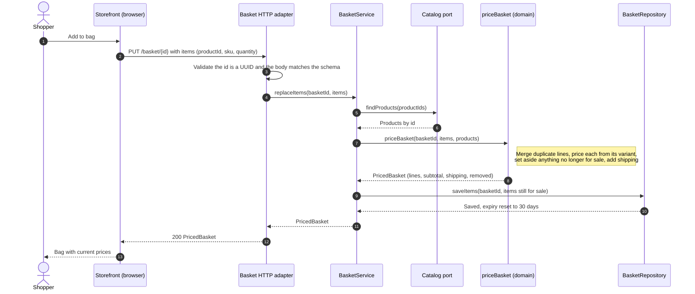
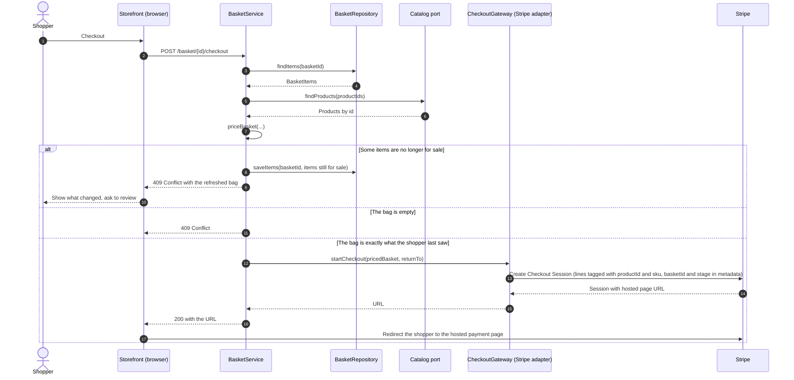
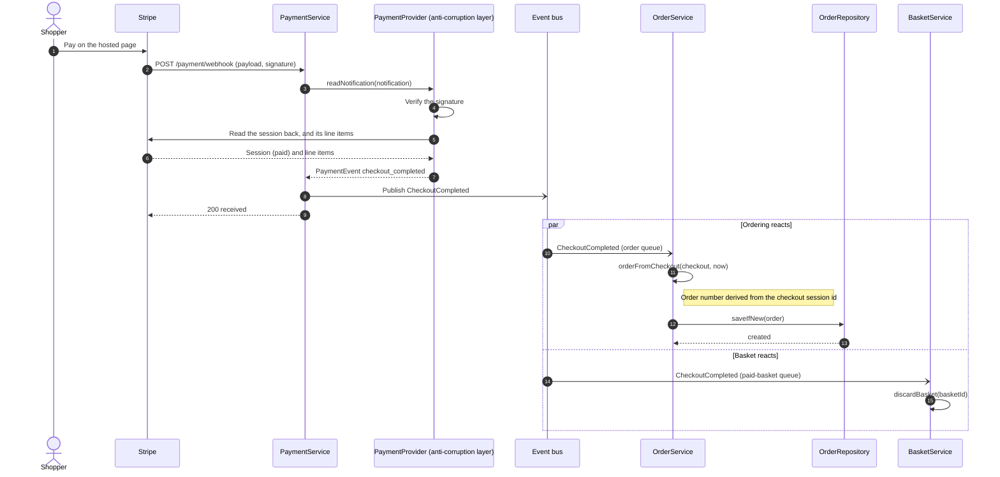
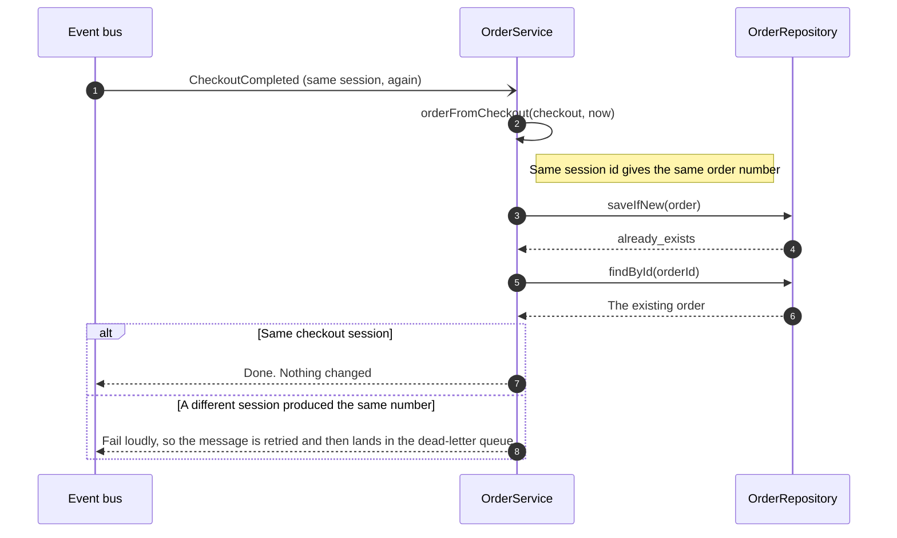
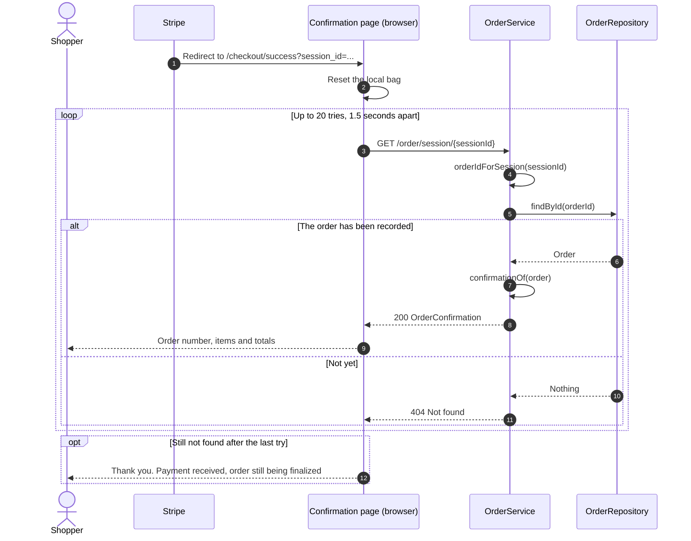
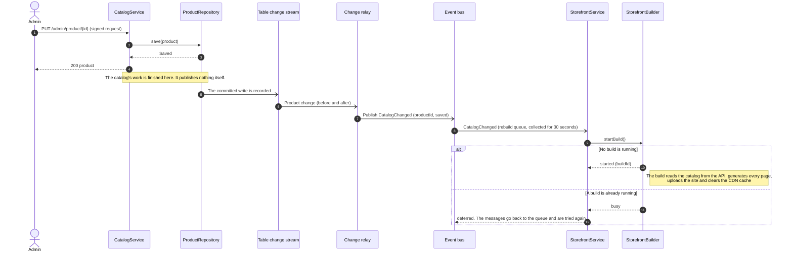

# Sequence diagrams

How objects and components talk to each other, in order, for the flows that matter most. Solid arrows are calls, dashed arrows are replies, and open arrowheads are asynchronous messages (events and queues), where the sender does not wait.

Participants are named as in the code: application services (`BasketService`), ports (`CheckoutGateway`, `OrderRepository`) and domain functions (`priceBasket`). See the [index](README.md) for the bounded contexts.

## 1. Saving the bag

The shopper adds an item. The browser sends ids and quantities only, and gets back a priced bag.

Source: `backend/src/basket/adapters/http.ts`, `backend/src/basket/application/basket-service.ts`, `backend/src/basket/domain/pricing.ts`.

Viewing the bag (`GET /basket/{id}`) is the same without the save (steps 9 and 10): the stored items are read, then priced from the current catalog.

## 2. Starting checkout

The basket context hands the shopper to Stripe. Nothing is charged here and no order exists yet.

Source: `backend/src/basket/application/basket-service.ts`, `backend/src/basket/adapters/stripe-checkout-gateway.ts`.

The rule in the first branch is the important one: a shopper is never charged for a bag that differs from what they last saw.

## 3. From payment to order

Stripe confirms the payment, the payment context announces it, and two other contexts react on their own.

Source: `backend/src/payment`, `backend/src/ordering/adapters/order-queue.ts`, `backend/src/basket/adapters/paid-basket-queue.ts`, `backend/lib/eventbus.ts`.

Things this diagram is designed to show:

- **The order is created from the webhook, never from the browser.** A shopper can pay and close the tab and still get their order.
- **Payment does not know ordering or basket exist.** It publishes one event. Adding a subscriber (confirmation emails, forwarding to a vendor) changes nothing upstream.
- **Stripe is answered only after the event is published.** If publishing fails, the webhook returns an error and Stripe delivers the notification again.

### What happens on a redelivery

Delivery is at-least-once at every hop, so the same `CheckoutCompleted` can arrive twice. The order's identity makes that harmless.

## 4. The confirmation page

The shopper returns from Stripe before the order may exist. The page waits for it.

Source: `web/src/components/order-confirmation.tsx`, `backend/src/ordering/application/order-service.ts`.

The session id is a long random value only the buyer's browser holds, and the page receives an `OrderConfirmation`, which leaves out payment and internal identifiers.

## 5. A catalog change reaches the storefront

An admin saves a product. About two minutes later the published site shows it, without anyone deploying anything.

Source: `backend/src/product`, `backend/src/product/change-relay.ts`, `backend/src/storefront`, `backend/lib/change-feed.ts`.

Why the event comes from the change stream and not from `CatalogService`: a service that both saves and publishes can do one and fail the other. The stream only contains writes that were committed, so the event can never announce a change that did not happen, and no committed change goes unannounced.
