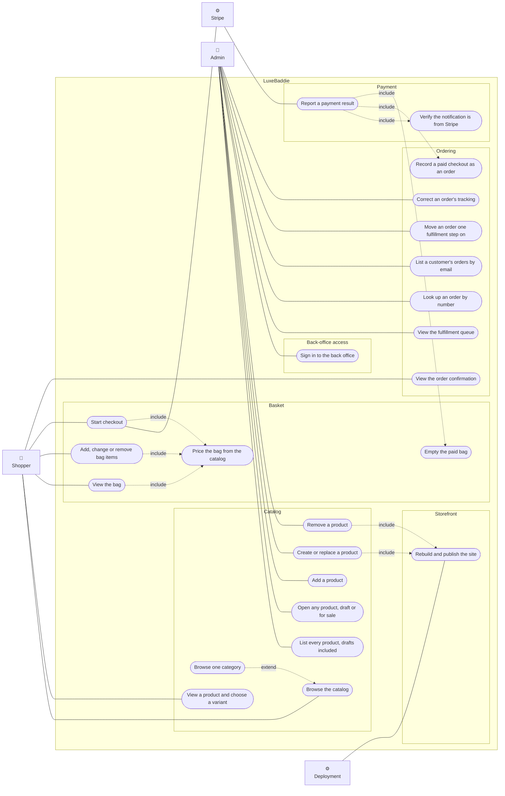
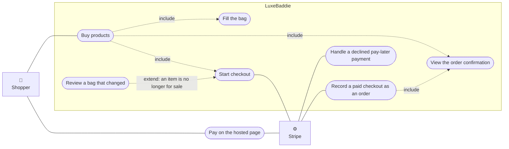
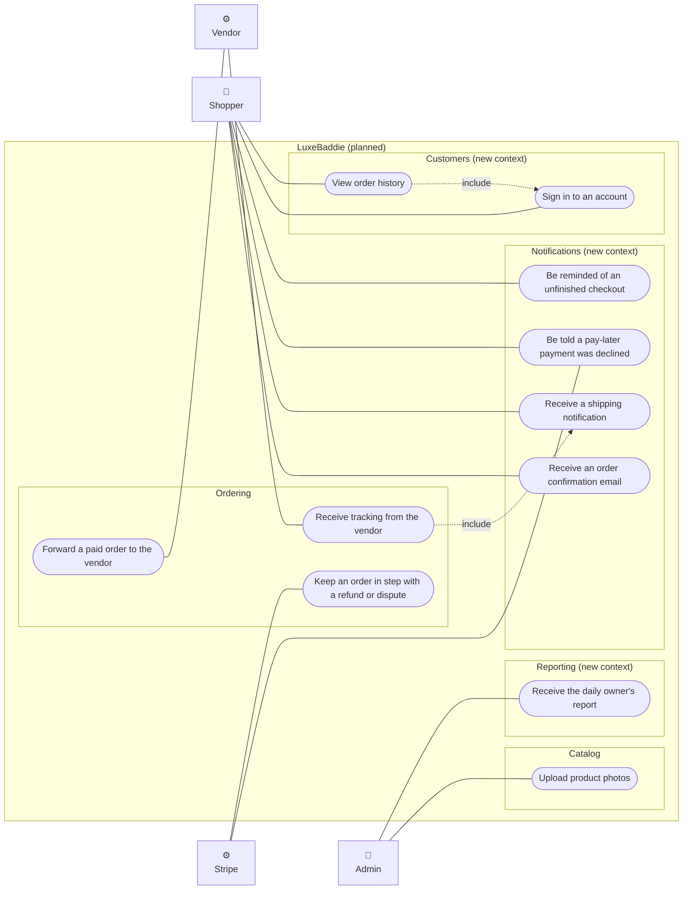

# Use case diagrams

The functional requirements of the application: who uses it, and what each actor can do with it. See the [index](README.md) for the bounded contexts.

Mermaid has no dedicated use case diagram, so these are drawn with its flowchart shapes in the standard UML layout: actors outside, the system as a box, each use case as an oval inside it. Dotted arrows labeled `include` and `extend` have their usual UML meaning:

- **include**: the first use case always performs the second as part of itself.
- **extend**: the second use case sometimes adds to the first, under a condition.

## Actors

| Actor | Kind | Who they are |
| --- | --- | --- |
| Shopper | Primary, human | Anyone browsing the store. Anonymous: there are no accounts |
| Admin | Primary, human | The business owner. Reaches the back-office functions two ways: signed in to the back office (`/backoffice/*` routes), or with AWS-signed requests from a script (`/admin/*` routes) |
| Stripe | Secondary, external system | Hosts the payment page and reports payment results |
| Deployment | Secondary, system | A finished deployment of the stack, which makes the published site out of date |

## What is built today

### Use cases, with their routes

| Actor | Use case | Context | Entry point | Rules worth knowing |
| --- | --- | --- | --- | --- |
| Shopper | Browse the catalog, or one category | Catalog | `GET /product`, `?category=` | Only products for sale are shown. The published pages are built from this ahead of time |
| Shopper | View a product and choose a variant | Catalog | `GET /product/{id}` | A draft product is "not found" to a shopper |
| Shopper | View the bag | Basket | `GET /basket/{id}` | Priced from the current catalog on every read. Unsaved or expired bags are empty |
| Shopper | Add, change or remove bag items | Basket | `PUT /basket/{id}`, `DELETE /basket/{id}` | At most 30 lines, quantity 1 to 10 each. Items no longer for sale are dropped and reported back |
| Shopper | Start checkout | Basket | `POST /basket/{id}/checkout` | Refused if the bag is empty or differs from what the shopper last saw |
| Shopper | View the order confirmation | Ordering | `GET /order/session/{sessionId}` | Shows no payment or internal identifiers. The order appears a moment after payment |
| Stripe | Report a payment result | Payment | `POST /payment/webhook` | Only from Stripe's addresses, with a valid signature. The session is read back from Stripe before anything is trusted |
| (event) | Record a paid checkout as an order | Ordering | `CheckoutCompleted` | Exactly one order per payment, however many times the event arrives |
| (event) | Empty the paid bag | Basket | `CheckoutCompleted` | Safe to repeat |
| Admin | Sign in to the back office | Back-office access | Amazon Cognito | By invitation only. Password, then a code from an authenticator app, every time. A session lasts 12 hours |
| Admin | List every product, drafts included | Catalog | `GET /admin/product` | |
| Admin | Open any product, draft or for sale | Catalog | `GET /admin/product/{id}` | |
| Admin | Add a product | Catalog | `POST /admin/product` | Refused if another product already has its id, which is its address in the shop |
| Admin | Create or replace a product | Catalog | `PUT /admin/product/{id}` | The whole product is replaced. SKUs unique, options consistent |
| Admin | Remove a product | Catalog | `DELETE /admin/product/{id}` | |
| Admin | View the fulfillment queue | Ordering | `GET /admin/order` | By fulfillment status, oldest first, paged |
| Admin | Look up an order by number | Ordering | `GET /admin/order/{id}` | |
| Admin | List a customer's orders by email | Ordering | `GET /admin/customer/{email}/order` | Newest first, paged |
| Admin | Move an order one fulfillment step on | Ordering | `POST /admin/order/{id}/fulfillment-step` | Ordered from the vendor, then shipped (carrier and tracking number required), then delivered. A step out of order is refused with the reason. Never backwards |
| Admin | Correct an order's tracking | Ordering | `PUT /admin/order/{id}/shipment` | Only while the order is on its way |

Every Admin route above also exists under `/backoffice` in place of `/admin`, for example `GET /backoffice/order`. The `/admin` copy accepts AWS-signed requests and the `/backoffice` copy accepts the signed-in owner's token; behind either, the use case is the same one.
| Admin, Deployment | Rebuild and publish the site | Storefront | `CatalogChanged`, or a finished deployment | One build at a time. A failed build leaves the previous site up and raises an alarm |

## The purchase, as one goal

The diagram above lists use cases by context. This one follows the shopper's single goal, buying something, across the contexts that each do a part of it.

Paying sits outside the system box on purpose: Stripe hosts the payment page, so card details never touch LuxeBaddie.

## On the roadmap

Planned use cases, from [ROADMAP.md](../ROADMAP.md). None of these are built. They are here so the model's direction is visible, and each one should move to the diagram above when it lands.

How these would fit the model:

- **The back-office screens** are a new client of the existing Admin use cases, not new use cases. Sign-in is built; the screens are not.
- **Vendor forwarding and tracking** automate two steps the Admin takes by hand today: marking an order as ordered from the vendor, and entering its tracking number. They would call the same fulfillment steps.
- **Notifications, reporting and vendor forwarding** each subscribe to events with their own queue, the way ordering and basket subscribe to `CheckoutCompleted` today. They need an `OrderPlaced` event published from the table's change stream (sketched in `backend/DATA-MODEL.md`). `CheckoutPaymentFailed` already exists and has no subscriber yet.
- **Customer accounts** introduce a `Customer` aggregate. Today a customer is only the email on an order.
